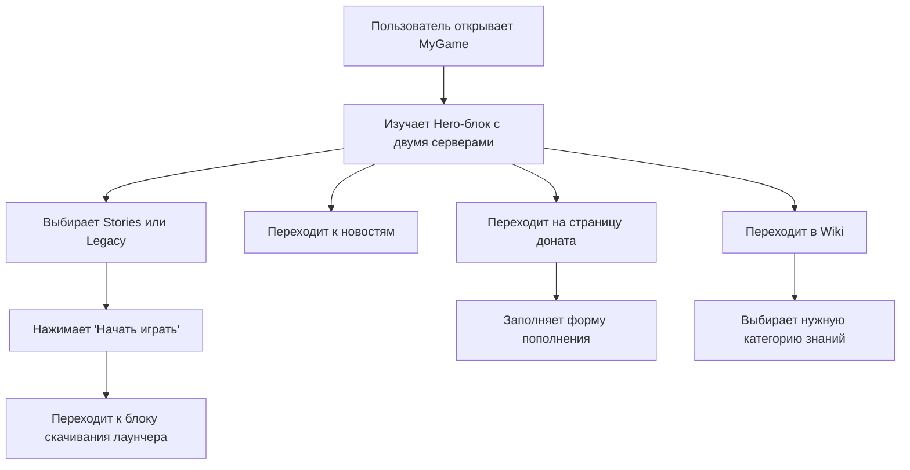

## 1. Обзор продукта
`MyGame` - темный премиальный игровой лендинг и веб-приложение с акцентом на два игровых сервера, быстрый вход в проект, новости, донат и базу знаний.
- Продукт решает задачу единой точки входа для новых и текущих игроков: знакомит с серверами, упрощает скачивание клиента, ведет к донату и навигации по Wiki.
- Основная ценность: современная презентация игрового проекта, усиление конверсии в начало игры и пополнение счета, повышение доверия к экосистеме проекта.

## 2. Ключевые функции

### 2.1 Роли пользователей
| Роль | Способ входа | Основные возможности |
|------|--------------|----------------------|
| Гость | Без авторизации | Просматривать лендинг, перейти к скачиванию, открыть Wiki, перейти на форум, заполнить форму доната |

### 2.2 Функциональные модули
1. **Главная страница**: герой-блок с двумя серверами, блок начала игры, новости, социальный и видео-блок.
2. **Страница доната**: форма пополнения счета с выбором сервера, никнейма, суммы и способа оплаты.
3. **Страница Wiki**: каталог игровых категорий с быстрым входом в разделы базы знаний.

### 2.3 Детализация страниц
| Название страницы | Название модуля | Описание функции |
|-------------------|-----------------|------------------|
| Главная | `Navbar` | Верхняя навигация с переходами на главную, новости, Wiki, форум и CTA-действиями справа |
| Главная | Hero Split | Первый экран с двумя крупными карточками `MyGame Stories` и `MyGame Legacy`, описанием, онлайном и CTA |
| Главная | Блок "Начать играть" | Две карточки платформ `Windows` и `Android` с кратким описанием и кнопкой скачивания |
| Главная | Новости | Сетка из 3-4 карточек с изображением-заглушкой, заголовком, описанием, датой и ссылкой на полную новость |
| Главная | Социальный блок | Визуально объединенные карточки Discord, Telegram, VK и YouTube с заметными иконками и hover-эффектами |
| Главная | `Footer` | Логотип, копирайт, правовые ссылки, контакты и социальные сети |
| Донат | Форма пополнения | Выбор сервера, никнейма, суммы, способа оплаты и расчетный блок бонусов |
| Донат | Инфо-блок | Поясняющий контент о безопасности платежей, бонусах и помощи пользователю |
| Wiki | Категории | Сетка или сайдбар с разделами: новичкам, начало игры, работы, организации, госструктуры, криминал, недвижимость, транспорт, команды, FAQ |
| Wiki | Обзор раздела | Вступительный блок с описанием назначения Wiki и быстрыми сценариями входа |

## 3. Основной пользовательский сценарий
Пользователь открывает главную страницу, выбирает интересующий сервер, затем либо начинает играть через скачивание клиента, либо углубляется в новости и Wiki. Отдельный мотивированный сценарий ведет пользователя на страницу доната, где он быстро заполняет форму пополнения.

## 4. Дизайн интерфейса
### 4.1 Дизайн-стиль
- Основная тема: темная, контрастная, в стиле премиального киберспортивного минимализма
- Основной акцент: `orange-500`, состояния наведения и активные элементы - `orange-600`
- Фон: `zinc-900`, карточки и панели - `zinc-800`
- Кнопки: крупные, скругленные, с мягким свечением и выразительным hover
- Шрифтовая пара: выразительный дисплейный шрифт для заголовков и нейтральный читаемый шрифт для текста
- Иконки: лаконичные, векторные, с неоновым свечением на интерактивных элементах
- Анимации: плавные появления, подъем карточек, мягкие градиентные засветы и акцентные Framer Motion reveal-эффекты

### 4.2 Обзор дизайна страниц
| Название страницы | Название модуля | Элементы UI |
|-------------------|-----------------|-------------|
| Главная | Hero Split | Две большие асимметричные карточки, оверлеи, индикатор онлайна, крупные CTA-кнопки, плавные анимации |
| Главная | Блок скачивания | Карточки платформ с иконкой устройства, коротким описанием и контрастной кнопкой |
| Главная | Новости | Адаптивная сетка карточек, медиа-заглушки, мета-информация, линк-кнопки |
| Главная | Социальный блок | Большие карточки соцсетей, иконки, рамки, свечение и hover-трансформации |
| Главная | `Navbar`/`Footer` | Единая темная оболочка, прозрачность, blur, разделители и аккуратные CTA |
| Донат | Форма | Пошаговая визуальная форма, селекты, поля ввода, переключатели и заметный итоговый блок |
| Wiki | Каталог | Карточки категорий или левый сайдбар, заголовки секций, краткие описания и быстрые действия |

### 4.3 Адаптивность
- Подход: desktop-first с корректной адаптацией под планшеты и мобильные экраны
- Навигация: на малых экранах компактный бургер или упрощенное меню с сохранением CTA
- Hero-блок: на мобильных экранах карточки серверов выстраиваются вертикально
- Карточные сетки: переход от 3-4 колонок к 1-2 колонкам без потери иерархии
- CTA и формы: большие зоны нажатия, удобные отступы, читаемая типографика, поддержка touch-взаимодействия
