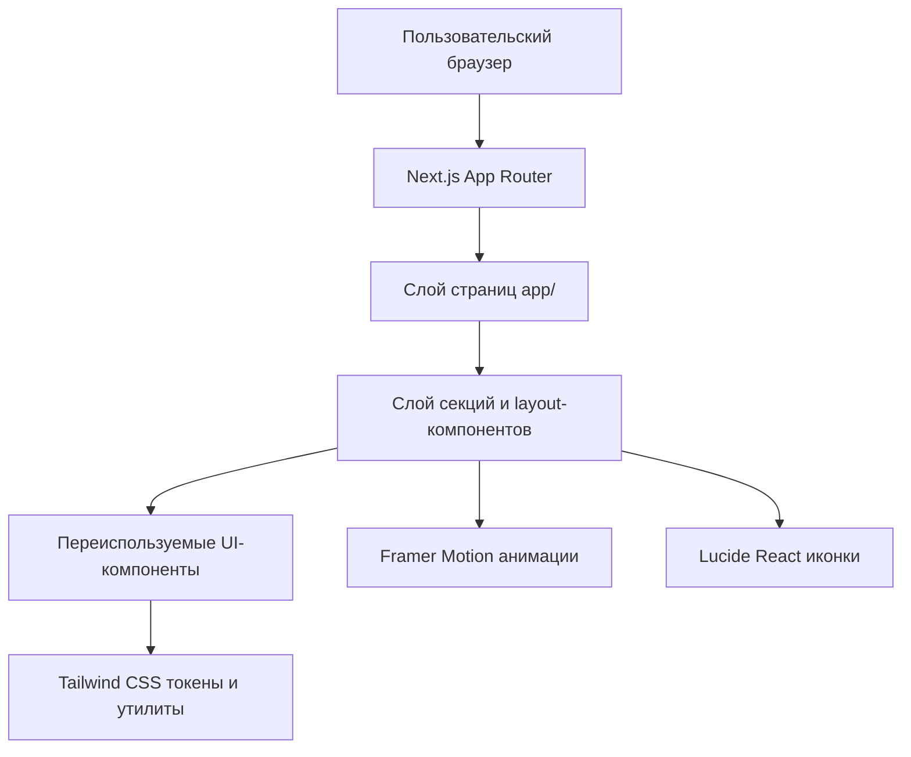

## 1. Архитектура решения


## 2. Технологическое описание
- Фронтенд: `Next.js 15` + `React` + `TypeScript`
- Маршрутизация: `App Router`
- Стилизация: `Tailwind CSS` с кастомной игровой палитрой
- Анимации: `Framer Motion`
- Иконки: `Lucide React`
- Инициализация и сборка: стандартный стек `create-next-app` / существующая Next.js-конфигурация

## 3. Определение маршрутов
| Маршрут | Назначение |
|---------|------------|
| `/` | Главная страница игрового проекта с hero-блоком, новостями, началом игры и социальными ссылками |
| `/donate` | Страница пополнения счета с формой и бонусным блоком |
| `/wiki` | Страница входа в базу знаний с каталогом игровых категорий |

## 4. Компонентная структура
| Слой | Элементы | Назначение |
|------|----------|------------|
| Layout | `Navbar`, `Footer` | Общая оболочка сайта, навигация и нижняя часть |
| UI | `Button`, `Card`, `SectionHeading`, `GlowBadge` | Базовые переиспользуемые элементы оформления |
| Главная | `HeroServers`, `StartPlaying`, `NewsGrid`, `SocialHub` | Сборка лендинга из независимых секций |
| Донат | `DonateForm`, `BonusSummary` | Ввод данных пользователя и отображение бонусов |
| Wiki | `WikiCategories`, `WikiHero` | Быстрый доступ к знаниям по разделам |

## 5. Структура директорий
```text
app/
  layout.tsx
  page.tsx
  donate/
    page.tsx
  wiki/
    page.tsx
components/
  layout/
    navbar.tsx
    footer.tsx
  ui/
    button.tsx
    card.tsx
  sections/
    hero-servers.tsx
    start-playing.tsx
    news-grid.tsx
    social-hub.tsx
    donate-form.tsx
    wiki-categories.tsx
lib/
  constants/
    navigation.ts
    mock-data.ts
```

## 6. Данные и типы
### 6.1 Типы данных интерфейса
```ts
export type ServerCard = {
  slug: "stories" | "legacy";
  title: string;
  description: string;
  online: number;
  ctaLabel: string;
};

export type NewsItem = {
  id: string;
  title: string;
  excerpt: string;
  publishedAt: string;
  imageLabel: string;
};

export type WikiCategory = {
  slug: string;
  title: string;
  description: string;
};
```

### 6.2 Источник данных
- На первом этапе используются локальные мок-данные в `lib/constants/mock-data.ts`
- Счетчики онлайна, новости и ссылки подготавливаются как статические конфигурации
- Архитектура оставляет простой путь к замене моков на API без переписывания UI-слоя

## 7. Стили и дизайн-токены
- Цвета расширяются в `tailwind.config.ts` через игровые токены для акцента, свечений и поверхностей
- Общие эффекты: градиентные бордеры, backdrop blur, тени и кольца фокуса
- Макет основан на контейнере фиксированной ширины с секционными отступами и адаптивными грид-сетками
- Все пользовательские тексты, комментарии в коде и описания интерфейса оформляются строго на русском языке

## 8. Анимации и производительность
- `Framer Motion` используется точечно для появления секций, hover-эффектов и hero-композиции
- Начальная загрузка избегает тяжелых фоновых видео и лишних клиентских зависимостей
- Декоративные эффекты реализуются преимущественно средствами CSS и Tailwind
- Компоненты проектируются небольшими и модульными, чтобы удерживать размер файлов и облегчать поддержку

## 9. Интеграции и ограничения
- Ссылка `Форум` ведет на внешний URL и открывается отдельно от внутренних маршрутов
- Формы доната в текущем этапе не подключаются к платежному API и работают как интерфейсный черновик
- Страницы подготавливаются для дальнейшего расширения новостным разделом и полноценной Wiki-навигацией
